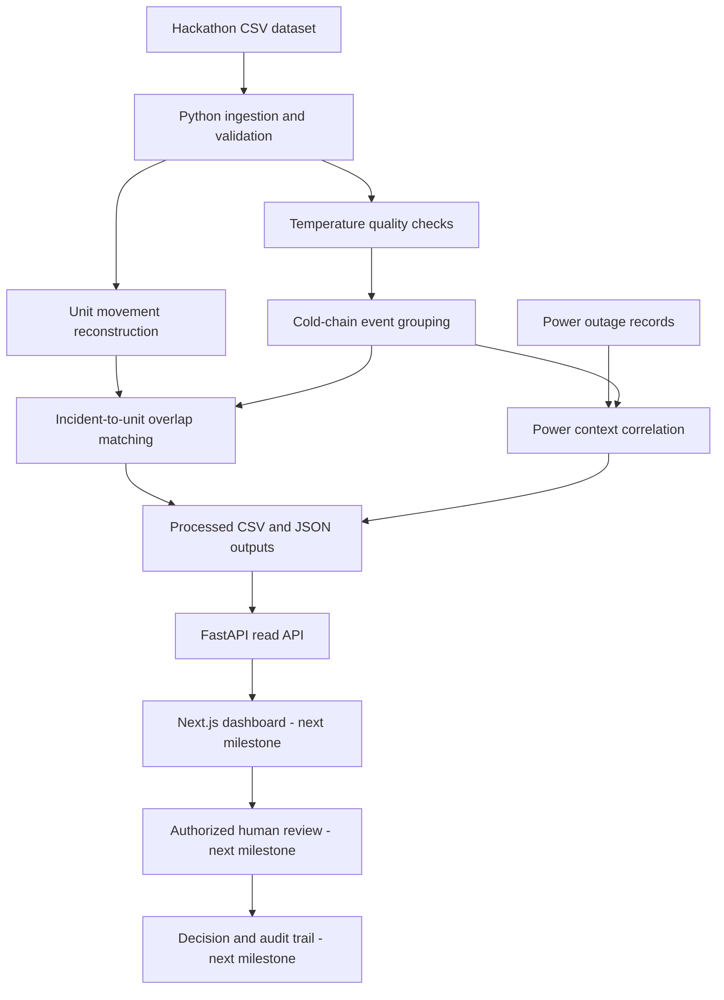

# TrustLedger architecture — Milestone 1

## Current data flow

1. The organizer's synthetic CSV files are placed in `data/raw/`.
2. The Python pipeline validates hourly temperature records, identifies sentinel glitches, estimates missing hourly observations, and groups out-of-range readings into episodes.
3. Episodes are classified as `warning` or `sustained`. The prototype's sustained escalation rule is four consecutive hourly readings above 6°C, matching the starter generator's excursion-day trigger. This is configurable and must be validated by a blood-service expert before any real-world use.
4. Unit holding intervals are reconstructed from the processing facility, screening completion date, opening-stock location and confirmed transfers. A unit is treated as in transit after dispatch until a receipt is confirmed. A missing `received_at` therefore creates an unknown-location period.
5. Sustained incidents are matched to RBC/WB unit holding intervals. These are investigation candidates, not proof of unsafe product.
6. Power outage intervals are correlated with temperature incident windows.
7. FastAPI exposes read-only endpoints for the Next.js interface.

## Current limitations

- Temperature records are hourly and have no fridge/device identifier; incident timing is approximate and assumes one monitored fridge stream per facility.
- Unit processing/release timestamps are not supplied. For new stock, `tested_date` is used as the earliest available proxy. Opening stock starts at 1 November 2025 and uses its recorded current facility as the opening location.
- A date-only `status_date` is treated as valid through the end of that day.
- Only RBC and WB units are included in this first 2–6°C traceability workflow. Component-specific rules require expert validation.
- The `temp_excursion_exposed` unit field is retained in an internal evaluation output only; it is not used to generate detections and is not returned by the API.
- No clinical disposition or blood release decision is automated.

## Wider system position

TrustLedger is an incident-detection and traceability workflow that would sit between facility sensor/inventory systems and the wider blood service information system. Future adapters could map unit identifiers to ISBT 128 and exchange relevant healthcare events through HL7 FHIR. Those standards are not implemented in this milestone.
